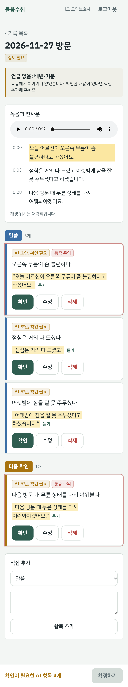
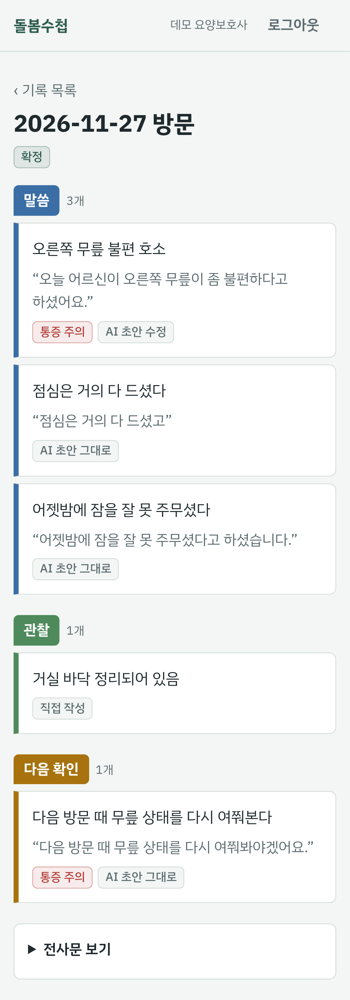
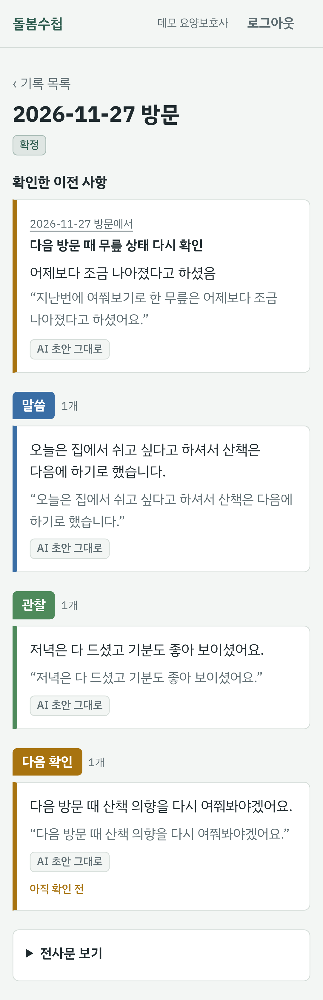
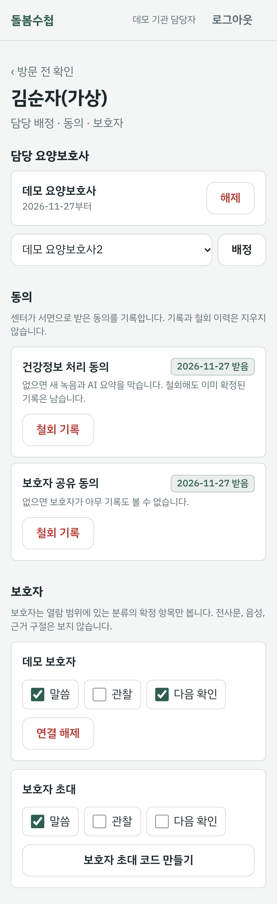

# 돌봄수첩 (CareServiceNote)

> 오늘의 기록을 다음 돌봄으로

방문요양 요양보호사가 방문 직후 남긴 짧은 음성 기록을 AI가 **수급자의 말씀 · 관찰 · 다음 확인 사항**으로 정리하고,
요양보호사가 확정한 기록을 다음 방문 전 확인, 담당자 인계, 후속 확인으로 이어 주는 서비스입니다.

## 왜 만들었나

- 장기요양 인정자 123만 5,045명(2025), 재가급여 수급자 중 독거가구 43.6%
- 요양보호사가 바뀌면 수급자의 생활 습관과 요청이 새 담당자에게 잘 전달되지 않고, 보호자는 같은 설명을 반복하게 됨
- 방문요양 평가 기준상 직원 변경 시 인계와 급여 개시 후 14일 이내 상담 기록 확인이 필요함

## 핵심 흐름

1. 방문 후 약 1분 음성 기록
2. STT → LLM이 분류 초안 생성 → 요양보호사가 검토·확정
3. 다음 방문 전 확인 사항과 인계 요약 조회 (요약마다 근거 기록 연결)
4. 방문 중 확인한 결과를 원래 기록에 연결

## 기술 스택

| 영역 | 사용 기술 |
|---|---|
| Backend | FastAPI, SQLAlchemy 2, Alembic, PostgreSQL |
| Frontend | Next.js (App Router), TypeScript, Tailwind CSS |
| AI | Whisper 계열 STT, LLM 구조화 출력 (로컬 / API 전환) |
| Infra | Docker Compose, GitHub Actions |

## 로컬 실행

```bash
# DB
docker compose up -d --wait

# Backend (http://localhost:8001/docs)
cd backend
cp .env.example .env          # JWT_SECRET을 임의 문자열로 바꾸기
uv sync
uv run alembic upgrade head
uv run python -m app.seed     # 데모 센터·역할별 계정(비밀번호 demo1234)과 가상 수급자
uv run uvicorn app.main:app --reload --port 8001

# AI 처리 워커 (다른 터미널)
cd backend
uv run python -m app.worker

# Frontend (http://localhost:3100)
cd frontend
pnpm install
pnpm dev                      # /api/* 요청은 BACKEND_URL(기본 http://127.0.0.1:8001)로 전달
```

### AI 처리 방식 (`AI_PROVIDER`)

| 값 | 전사 | 분류 | 준비 |
|---|---|---|---|
| `fake` | 고정 가상 전사문 | 고정 분류 결과 | 없음 (기본값) |
| `local` | mlx-whisper | Ollama | macOS, `uv sync --group local`, `ollama pull qwen2.5:7b` |
| `gemini` | Gemini | Gemini | Google AI Studio 무료 등급 키를 `GEMINI_API_KEY`에 (기본 모델 `gemini-3.5-flash-lite`, 무료 등급에서 음성 입력 지원) |

## 테스트

```bash
cd backend && uv run pytest              # 테스트 DB(csn_test) 자동 생성
cd backend && uv run pytest -m live -s   # 실제 AI 모델 호출 (수동)
cd frontend && pnpm lint && pnpm test && pnpm build   # 단위 테스트는 Node 내장 테스트 러너
cd frontend && pnpm e2e                  # Playwright E2E (fake AI 백엔드·워커를 자동 실행, DB는 docker compose로 먼저 띄우기)
```

E2E는 이미 8001·3100 포트에 떠 있는 서버를 재사용하므로, 직접 띄워 둔 백엔드가 있다면 `AI_PROVIDER=fake`여야 합니다.

## 화면 흐름

<p>
  
  
  
  
</p>

화면 예시는 모두 가상 데이터이며, 검토 화면은 Gemini 무료 등급으로 실제 처리한 결과입니다.

1. 가입·로그인 → 수급자 선택
2. 녹음 전 고지 확인 → 녹음(또는 음성 파일) → 기록 올리기
3. 처리 중 화면(전사 → 분류) → 검토
   - 말씀 / 관찰 / 다음 확인 항목마다 AI 초안 표시, 근거 구절을 누르면 전사문 구간 강조 + 그 시점부터 재생
   - 녹음에서 근거를 찾지 못한 항목, 위험 항목(낙상·복약·통증), 언급 없는 주제 안내
   - AI 항목을 모두 확인·수정·삭제해야 확정 가능
4. 확정 후에는 읽기 전용, 항목마다 출처(AI 초안 그대로 / 수정 / 직접 작성) 표시

### 다음 방문으로 잇기 (방문 전 확인 · 후속 확인 · 인계 요약 · 검색)

<p>
  
  
  
</p>

- **후속 확인**: 지난 방문의 '다음 확인' 항목을 다음 녹음 분류 때 함께 넘기면, AI가 답이 되는 구절을 근거와 함께 제안합니다. 요양보호사가 확인·수정·삭제하고 확정하면 결과가 원래 항목에 연결됩니다(담당자가 바뀌어도 수급자 기준으로 이어짐).
- **방문 전 확인**: 남은 확인 사항, 기간(7·14·30일) 내 주의 항목과 최근 확인 결과, 후속 확인 완료율.
- **AI 인계 요약**: 확정 항목만으로 최대 5문장. 문장마다 근거 항목을 달고, 근거가 없는 문장은 서버가 버립니다. 요약 뒤 새 기록이 확정되면 표시합니다.
- **검색**: 수급자 기록 안에서 확정 항목·확인 결과·전사문을 부분 문자열로 찾습니다(`pg_trgm`).

### 센터 · 역할 · 동의 · 보호자

<p>
  
  
  
  
</p>

| 데모 계정 (비밀번호 `demo1234`) | 역할 | 볼 수 있는 것 |
|---|---|---|
| `manager` | 기관 담당자 | 센터 수급자 전부의 확정 기록, 담당 배정·동의·초대·보호자 관리, 센터 확인 서명 |
| `demo` | 요양보호사 | 지금 배정된 수급자의 확정 기록 + 내가 쓴 확정 전 기록 |
| `demo2` | 요양보호사 | 배정 없음 (담당 교체 시연용) |
| `family` | 보호자 | 김순자(가상)의 확정 항목 중 말씀·다음 확인만 |

- **가입**: 센터를 만들면 기관 담당자, 요양보호사와 보호자는 기관 담당자가 만든 일회용 초대 코드(7일, DB에는 해시만)로 가입합니다.
- **담당 배정**: 요양보호사는 지금 배정된 수급자만 봅니다. 배정을 해제하면 다음 요청부터 확정 전 초안과 음성까지 볼 수 없습니다.
- **동의**: 센터가 서면으로 받은 건강정보 처리·보호자 공유 동의를 날짜와 함께 기록합니다. 건강정보 동의가 없거나 철회되면 새 녹음, 이미 올라간 녹음의 AI 처리, 확정, AI 요약을 막고, 이미 확정된 기록 열람은 유지합니다.
- **보호자**: 보호자마다 열람 범위(말씀/관찰/다음 확인)를 정합니다. 보호자 API는 보여 줄 필드만 따로 정의해서 전사문·음성·근거 구절·요양보호사 이름이 나가지 않습니다. 연결 해제나 계정 비활성화는 다음 요청부터 바로 적용됩니다.
- **권한 확인 한 곳**: 모든 수급자·기록 API가 `app/access.py`를 거칩니다. 볼 수 없는 수급자·기록은 존재를 숨기려고 404입니다. 역할 5종 × 엔드포인트 27개 접근 표 테스트가 있고, 표에 없는 API가 생기면 테스트가 실패합니다.

### 오프라인 녹음

업로드 중 연결이 끊기거나 서버 오류가 나면 녹음을 브라우저 IndexedDB(`csn-offline`)에 저장하고, 앱을 다시 열거나 연결이 돌아오면 같은 기록 ID로 다시 올립니다(서버가 같은 ID를 중복 저장하지 않음). 대기열에는 음성, 기록·수급자·사용자 UUID, 날짜만 저장하고 수급자 이름은 넣지 않습니다. 로그아웃하거나 다른 사용자가 로그인하면 기기에 남은 녹음을 지웁니다.

## 개인정보 원칙

이 저장소의 모든 수급자·기록 데이터는 가상으로 만든 것입니다. 실제 건강정보는 사용하지 않습니다.

데모의 Gemini 연동은 무료 등급을 사용합니다. 무료 등급은 입력 데이터가 서비스 개선에 쓰일 수 있으므로 가상 데이터만 넣으며, 실제 기록을 다룬다면 데이터 학습에 쓰이지 않는 유료 등급으로 바꿔야 합니다.
