# 돌봄수첩 (CareServiceNote)

> 오늘의 기록을 다음 돌봄으로

방문요양 요양보호사가 방문 직후 남긴 짧은 음성 기록을 AI가 **수급자의 말씀 · 관찰 · 다음 확인 사항**으로 정리하고,
요양보호사가 확정한 기록을 다음 방문 전 확인, 담당자 인계, 후속 확인으로 이어 주는 서비스입니다.

## 왜 만들었나

- 장기요양 인정자 123만 5,045명(2025), 재가급여 수급자 중 독거가구 43.6%
- 요양보호사가 바뀌면 수급자의 생활 습관과 요청이 새 담당자에게 잘 전달되지 않고, 보호자는 같은 설명을 반복하게 됨
- 방문요양 평가 기준상 직원 변경 시 인계와 급여 개시 후 14일 이내 상담 기록 확인이 필요함

## 핵심 흐름

1. 방문 후 약 1분 음성 기록
2. STT → LLM이 분류 초안 생성 → 요양보호사가 검토·확정
3. 다음 방문 전 확인 사항과 인계 요약 조회 (요약마다 근거 기록 연결)
4. 방문 중 확인한 결과를 원래 기록에 연결

## 기술 스택

| 영역 | 사용 기술 |
|---|---|
| Backend | FastAPI, SQLAlchemy 2, Alembic, PostgreSQL |
| Frontend | Next.js (App Router), TypeScript, Tailwind CSS |
| AI | Whisper 계열 STT, LLM 구조화 출력 (로컬 / API 전환) |
| Infra | Docker Compose, GitHub Actions |

## 로컬 실행

```bash
# DB
docker compose up -d --wait

# Backend (http://localhost:8001/docs)
cd backend
cp .env.example .env          # JWT_SECRET을 임의 문자열로 바꾸기
uv run python -m app.storage  # 출력된 키를 .env의 STORAGE_KEY에 (음성·사진 암호화, 잃으면 파일을 못 읽음)
uv sync
uv run alembic upgrade head
uv run python -m app.seed     # 데모 센터·역할별 계정(비밀번호 demo1234)과 가상 수급자
uv run uvicorn app.main:app --reload --port 8001

# AI 처리 워커 (다른 터미널)
cd backend
uv run python -m app.worker

# Frontend (http://localhost:3100)
cd frontend
pnpm install
pnpm dev                      # /api/* 요청은 BACKEND_URL(기본 http://127.0.0.1:8001)로 전달
```

### AI 처리 방식 (`AI_PROVIDER`)

| 값 | 전사 | 분류 | 준비 |
|---|---|---|---|
| `fake` | 고정 가상 전사문 | 고정 분류 결과 | 없음 (기본값) |
| `local` | mlx-whisper | Ollama | macOS, `uv sync --group local`, `ollama pull qwen2.5:7b` |
| `gemini` | Gemini | Gemini | Google AI Studio 무료 등급 키를 `GEMINI_API_KEY`에 (기본 모델 `gemini-3.5-flash-lite`, 무료 등급에서 음성 입력 지원) |

## 배포

서버 한 대에 Docker Compose로 DB·API·워커·화면·Caddy(자동 HTTPS)를 함께 띄웁니다. 순서와 백업·복구는 [deploy/DEPLOY.md](deploy/DEPLOY.md).

```bash
cd deploy && cp .env.example .env   # DOMAIN, 비밀값, GEMINI_API_KEY 채우기
docker compose up -d --build
```

- `ENV=production`이면 위험한 설정(HTTP 쿠키, 짧은 JWT 비밀값, 암호화 키 없음 등)으로는 시작하지 않습니다.
- `/api`는 Caddy가 API로 바로 보내고(업로드가 화면 서버를 거치지 않음), DB·API 포트는 밖으로 열지 않습니다.
- 로그인·초대 코드 시도 횟수 제한은 Caddy가 넘겨주는 클라이언트 IP 기준이고, 아이디별 상한을 넘으면 전에 로그인했던 기기만 통과합니다.

## 테스트

```bash
cd backend && uv run pytest              # 테스트 DB(csn_test) 자동 생성
cd backend && uv run pytest -m live -s   # 실제 AI 모델 호출 (수동)
cd frontend && pnpm lint && pnpm test && pnpm build   # 단위 테스트는 Node 내장 테스트 러너
cd frontend && pnpm e2e                  # Playwright E2E (fake AI 백엔드·워커를 자동 실행, DB는 docker compose로 먼저 띄우기)
```

E2E는 이미 8001·3100 포트에 떠 있는 서버를 재사용하므로, 직접 띄워 둔 백엔드가 있다면 `AI_PROVIDER=fake`여야 합니다.

## 화면 흐름

<p>
  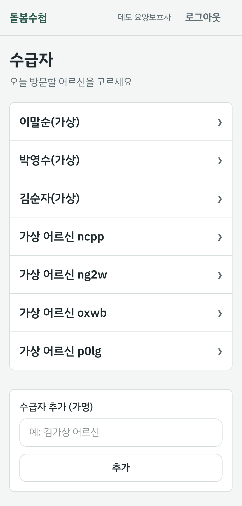
  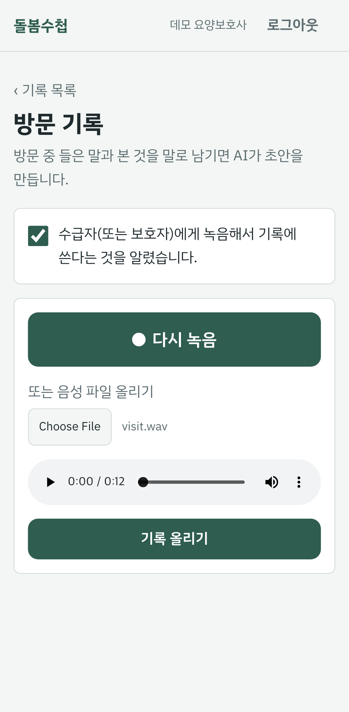
  
  
</p>

화면 예시는 모두 가상 데이터이며, 검토 화면은 Gemini 무료 등급으로 실제 처리한 결과입니다.

1. 가입·로그인 → 수급자 선택
2. 녹음 전 고지 확인 → 녹음(또는 음성 파일) → 기록 올리기
3. 처리 중 화면(전사 → 분류) → 검토
   - 말씀 / 관찰 / 다음 확인 항목마다 AI 초안 표시, 근거 구절을 누르면 전사문 구간 강조 + 그 시점부터 재생
   - 녹음에서 근거를 찾지 못한 항목, 위험 항목(낙상·복약·통증), 언급 없는 주제 안내
   - AI 항목을 모두 확인·수정·삭제해야 확정 가능
4. 확정 후에는 읽기 전용, 항목마다 출처(AI 초안 그대로 / 수정 / 직접 작성) 표시

### 다음 방문으로 잇기 (방문 전 확인 · 후속 확인 · 인계 요약 · 검색)

<p>
  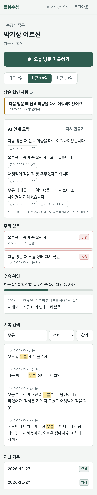
  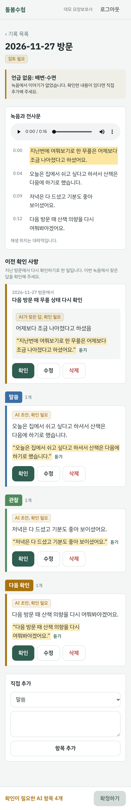
  
</p>

- **후속 확인**: 지난 방문의 '다음 확인' 항목을 다음 녹음 분류 때 함께 넘기면, AI가 답이 되는 구절을 근거와 함께 제안합니다. 요양보호사가 확인·수정·삭제하고 확정하면 결과가 원래 항목에 연결됩니다(담당자가 바뀌어도 수급자 기준으로 이어짐).
- **방문 전 확인**: 남은 확인 사항, 기간(7·14·30일) 내 주의 항목과 최근 확인 결과, 후속 확인 완료율.
- **AI 인계 요약**: 확정 항목만으로 최대 5문장. 문장마다 근거 항목을 달고, 근거가 없는 문장은 서버가 버립니다. 요약 뒤 새 기록이 확정되면 표시합니다.
- **검색**: 수급자 기록 안에서 확정 항목·확인 결과·전사문을 부분 문자열로 찾습니다(`pg_trgm`).

### 센터 · 역할 · 동의 · 보호자

<p>
  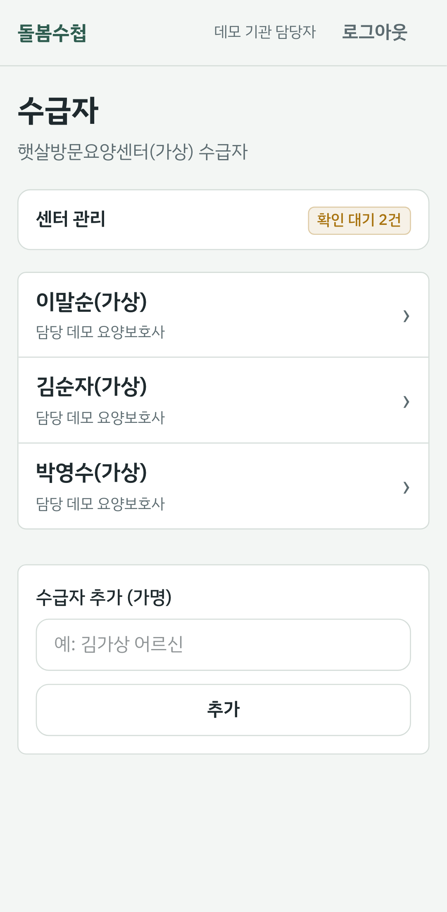
  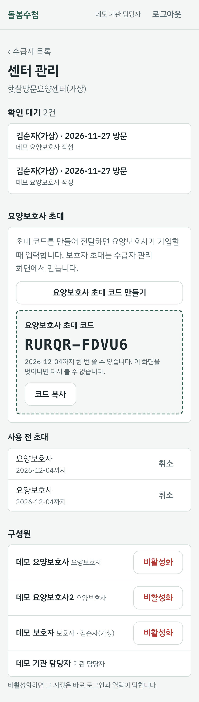
  
  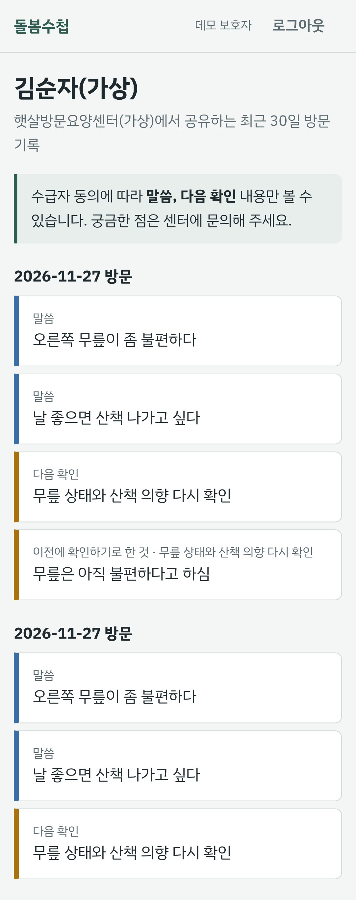
</p>

| 데모 계정 (비밀번호 `demo1234`) | 역할 | 볼 수 있는 것 |
|---|---|---|
| `manager` | 기관 담당자 | 센터 수급자 전부의 확정 기록, 담당 배정·동의·초대·보호자 관리, 센터 확인 서명 |
| `demo` | 요양보호사 | 지금 배정된 수급자의 확정 기록 + 내가 쓴 확정 전 기록 |
| `demo2` | 요양보호사 | 배정 없음 (담당 교체 시연용) |
| `family` | 보호자 | 김순자(가상)의 확정 항목 중 말씀·다음 확인만 |

- **가입**: 센터를 만들면 기관 담당자, 요양보호사와 보호자는 기관 담당자가 만든 일회용 초대 코드(7일, DB에는 해시만)로 가입합니다.
- **담당 배정**: 요양보호사는 지금 배정된 수급자만 봅니다. 배정을 해제하면 다음 요청부터 확정 전 초안과 음성까지 볼 수 없습니다.
- **동의**: 센터가 서면으로 받은 건강정보 처리·보호자 공유 동의를 날짜와 함께 기록합니다. 건강정보 동의가 없거나 철회되면 새 녹음, 이미 올라간 녹음의 AI 처리, 확정, AI 요약을 막고, 이미 확정된 기록 열람은 유지합니다.
- **보호자**: 보호자마다 열람 범위(말씀/관찰/다음 확인)를 정합니다. 보호자 API는 보여 줄 필드만 따로 정의해서 전사문·음성·근거 구절·요양보호사 이름이 나가지 않습니다. 연결 해제나 계정 비활성화는 다음 요청부터 바로 적용됩니다.
- **권한 확인 한 곳**: 모든 수급자·기록 API가 `app/access.py`를 거칩니다. 볼 수 없는 수급자·기록은 존재를 숨기려고 404입니다. 역할 5종 × 엔드포인트 27개 접근 표 테스트가 있고, 표에 없는 API가 생기면 테스트가 실패합니다.

### 변화 알림 · 긴급 우려 · 센터 인박스

<p>
  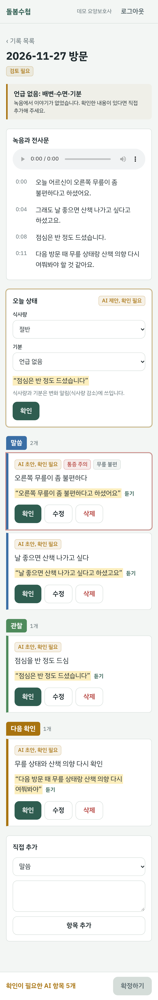
  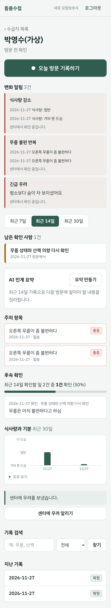
  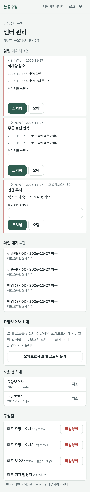
</p>

- **AI는 값만, 알림은 규칙이**: AI가 항목마다 불편 부위(좌우 구분 없는 12개)를, 방문마다 식사량(0~4)과 기분을 근거 구절과 함께 제안합니다. 요양보호사가 확인한 값만 저장하고, 근거가 전사문에 없으면 제안하지 않습니다.
- **규칙** (기획안 그대로): 7일 이내 서로 다른 두 방문에 같은 부위 불편 → 알림, 식사량이 기록된 두 방문(7일 이내)에서 2단계 이상 감소 → 알림. 발화자가 불분명한 항목은 제외하고, 같은 사유의 미처리 알림이 있으면 근거만 합칩니다.
- **긴급 우려**: 요양보호사가 규칙과 관계없이 센터에 직접 올립니다. 응급 상황은 앱이 아니라 119와 센터 전화가 먼저라고 안내합니다.
- **센터 인박스**: 기관 담당자가 근거 기록을 열어 보고 조치함/오탐과 메모로 처리합니다.

### 보호자 하루 요약 · 방문 시각 · 센터 안내 · 업무 메시지

<p>
  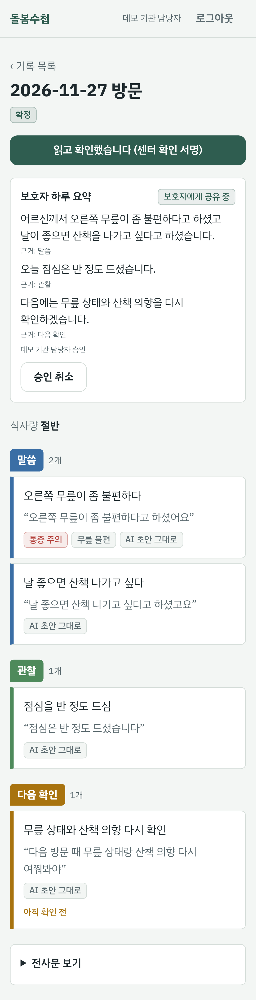
  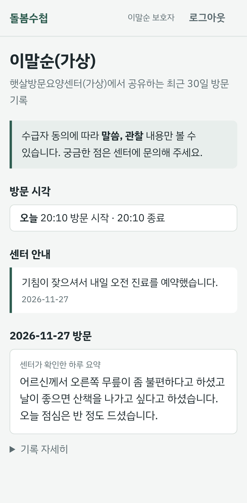
  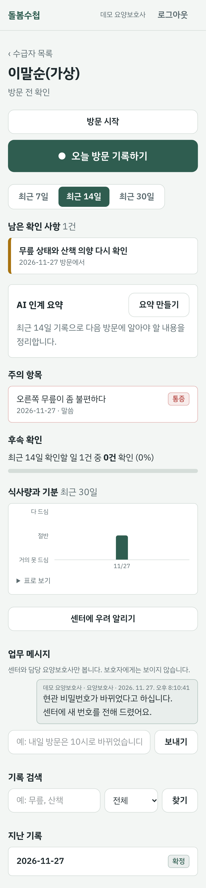
</p>

- **보호자 하루 요약**: 확정 항목만(전사문 제외)으로 AI가 최대 3문장을 쓰고 문장마다 근거 항목을 답니다. 기관 담당자가 문장을 고치거나 지운 뒤 **승인해야** 보호자에게 보입니다.
- **열람 범위는 문장 단위로**: 요약은 방문당 하나만 만들고, 보호자에게는 근거 항목이 모두 그 보호자의 열람 범위 안에 있는 문장만 보냅니다. (위 예시: 말씀·관찰 범위의 보호자에게 '다음 확인' 문장은 빠짐, Gemini 실제 결과)
- **방문 시작·종료**: 요양보호사가 누르면 보호자 화면에 시각만 나갑니다. 위치는 수집하지 않습니다.
- **센터 안내**: 알림을 처리할 때 기관 담당자가 보호자용 안내문을 따로 쓰고 받을 보호자를 고릅니다. 알림 근거와 요양보호사의 우려 원문은 보내지 않습니다.
- **업무 메시지**: 수급자별로 기관 담당자와 담당 요양보호사만 봅니다.

### 정정 · 열람 이력 · 내보내기

<p>
  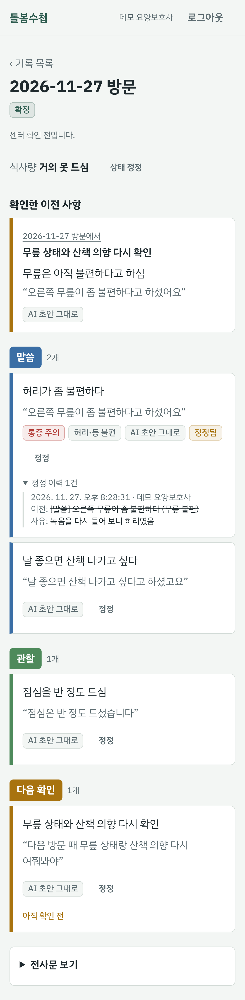
  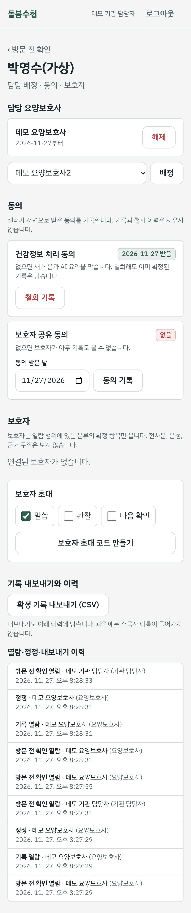
</p>

- **정정**: 작성자(지금 배정 중)와 기관 담당자가 확정 항목과 오늘 상태를 **사유와 함께** 고칩니다. 이전 값은 정정 이력으로 남고 화면에 "정정됨"으로 표시됩니다.
- **정정 뒤 처리**: 센터 확인 서명은 다시 확인 대기로 돌아가고, 정정한 항목을 근거로 쓴 승인된 보호자 요약은 승인이 취소됩니다. 변화 알림은 다시 평가해서 조건이 사라지면 "정정으로 닫힘"이 됩니다.
- **감사 로그**: 기록 열람, 방문 전 확인, 검색, 보호자 화면, 정정, 내보내기를 누가 언제 했는지 남깁니다. 검색어나 기록 내용은 남기지 않습니다.
- **내보내기**: 기관 담당자가 확정 기록을 CSV로 받습니다(엑셀용 UTF-8 BOM, 파일 이름에 수급자 이름 없음, 수식으로 실행될 수 있는 칸은 무력화).

### 저장과 보관

<p>
  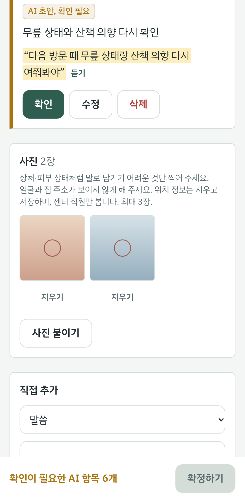
</p>

- **암호화 저장**: 음성과 사진은 `STORAGE_KEY`로 암호화(Fernet)해 저장하고(파일 권한 600), AI 처리나 화면에 내려줄 때만 메모리에서 복호화합니다. 로컬 STT처럼 파일 경로가 필요한 처리는 처리하는 동안만 임시 파일을 씁니다.
- **보관 기간**: 워커가 한 시간마다 확정되지 않은 기록의 음성·사진(30일)과 확정 기록의 전사문·초안(180일)을 지웁니다. 확정 항목과 근거 구절은 공식 기록이라 남깁니다. 확정하면 음성은 바로 지웁니다(1단계부터).
- **전사문 마스킹**: 전사 직후, 저장하고 AI 분류에 넘기기 전에 전화번호·이메일·주민등록번호 형태를 `[전화번호]` 등으로 가립니다. 말로 읽은 번호("공일공…")와 이름은 잡지 못합니다.
- **사진**: 확정 전 검토 화면에서 최대 3장. 다시 인코딩해 EXIF(촬영 위치·기기 정보)를 지우고 1600px로 줄입니다. 센터 직원만 보고 보호자에게는 보내지 않습니다.

### 오프라인 녹음

업로드 중 연결이 끊기거나 서버 오류가 나면 녹음을 브라우저 IndexedDB(`csn-offline`)에 저장하고, 앱을 다시 열거나 연결이 돌아오면 같은 기록 ID로 다시 올립니다(서버가 같은 ID를 중복 저장하지 않음). 대기열에는 음성, 기록·수급자·사용자 UUID, 날짜만 저장하고 수급자 이름은 넣지 않습니다. 로그아웃하거나 다른 사용자가 로그인하면 기기에 남은 녹음을 지웁니다.

## 품질 평가

가상 시나리오 19개(개선할 때 본 dev 14개 + 일반화를 보려고 따로 둔 holdout 5개)로 분류·요약 품질을, 알림 시나리오 10개로 규칙을 잽니다. 무릎 담요(부위 오탐), 라디오 속 다른 사람 말(발화자 불분명), 답이 없는 이전 확인 사항처럼 일부러 헷갈리게 만든 사례를 넣었습니다.

```bash
cd backend && uv run python -m app.evaluation --provider local --repeat 3   # 또는 --provider gemini --pace 5, --stt
```

| | Gemini 3.5 Flash-Lite | qwen2.5:7b (로컬) |
|---|---|---|
| 항목 재현율 / 정밀도 (dev, 개선 후) | 84% / 92% | 59% / 100% |
| 항목 재현율 / 정밀도 (holdout) | 100% / 100% | 80% / 80% |
| 근거 일치율 · 요약 근거율 | 100% · 100% | 100% · 100% |
| 분류 시간 | 약 1.5초 | 약 21초 |

- 알림 규칙 시나리오는 CI에서 전부 맞아야 통과합니다.
- 평가로 찾아 고친 것: 근거 없는 후속 확인 답 버리기, 로컬 모델의 반복 생성 막기, 부위·기분·항목 나누기 프롬프트. 프롬프트 개선이 Gemini에는 효과가 있었지만 7B 로컬 모델에는 엇갈린 결과(지어낸 기분은 줄고 항목 재현율은 떨어짐)까지 [docs/eval](docs/eval/README.md)에 그대로 적었습니다.

## 개인정보 원칙

이 저장소의 모든 수급자·기록 데이터는 가상으로 만든 것입니다. 실제 건강정보는 사용하지 않습니다.

데모의 Gemini 연동은 무료 등급을 사용합니다. 무료 등급은 입력 데이터가 서비스 개선에 쓰일 수 있으므로 가상 데이터만 넣으며, 실제 기록을 다룬다면 데이터 학습에 쓰이지 않는 유료 등급으로 바꿔야 합니다.
